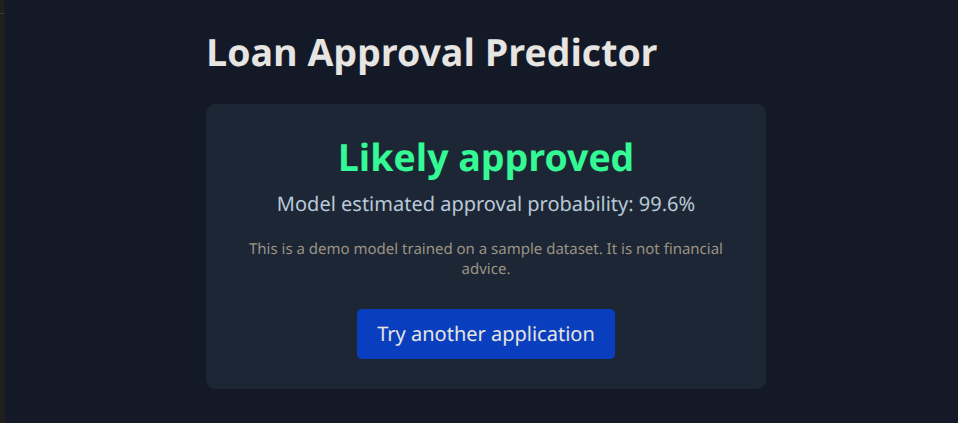
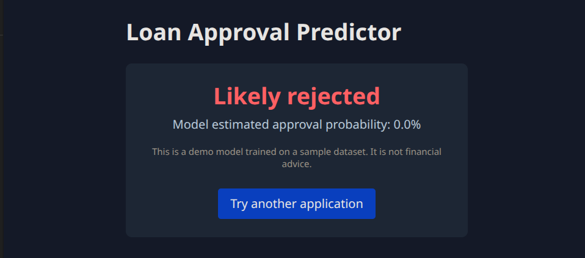

# Loan Approval Predictor (Frontend)

A React single-page app where a user enters a loan application and gets an instant approval prediction from a machine-learning model.

**Live demo:** https://loan-approval-frontend-sof5.onrender.com

> The backend runs on Render's free tier, which sleeps when idle. The first request after a quiet period can take about 50 seconds. After that it responds in well under a second.

## Screenshots

| Likely approved | Likely rejected |
| --- | --- |
|  |  |

## How it works

```
Browser (React + Vite) --POST JSON--> Django REST API --> Gradient Boosting model
                                ^                                      |
                                +------- prediction + probability ------+
```

1. The user fills in 13 fields (8 numeric, 5 dropdowns).
2. The form converts the numbers and sends them to `POST /api/predict/`.
3. The Django API validates the input, runs the trained model, and returns `{"prediction", "approved", "probability"}`.
4. The app shows the result and the estimated approval probability.
5. If the API rejects the input, each error is shown under the matching field.

## Tech stack

- React 19 with Vite
- Tailwind CSS v4
- `fetch` for API calls, in a single helper (`src/api/predict.js`)
- Deployed as a Render Static Site

## Project structure

```
src/
  api/predict.js              the one function that calls the Django API
  components/LoanForm.jsx     the 13 input fields, validation errors, submit logic
  components/ResultCard.jsx   approved / rejected result screen
  App.jsx                     switches between the form and the result
```

## Run it locally

You need Node.js 20.19 or newer.

```bash
git clone https://github.com/voss-dev/loan-approval-frontend.git
cd loan-approval-frontend
npm install
npm run dev
```

Open http://localhost:5173. By default the app calls a Django server at `http://127.0.0.1:8000`, so run the backend too (see the backend repo below).

### Pointing at a different API

Set `VITE_API_URL` before building. For example, create a `.env` file:

```
VITE_API_URL=https://saas-django-app.onrender.com
```

Vite reads this at **build time**, so rebuild or redeploy after changing it. `.env` is git-ignored.

## Related repositories

- Backend API: https://github.com/voss-dev/saas-django-app
- Model training and experiments: https://github.com/voss-dev/loan-approval-ml

## Limitations

- The model is a demo trained on a public sample dataset. It is not financial advice and must not be used for real lending decisions.
- The model uses `person_gender` as an input feature because it was in the dataset. A real lending system should not do this.